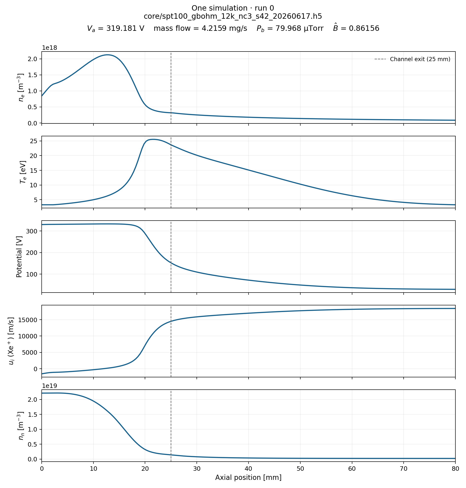
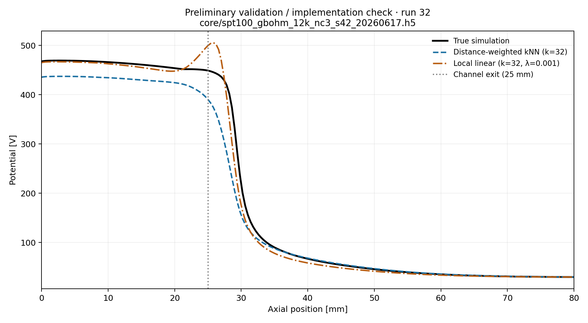

# Stage one: Hall-thruster surrogate modeling

## Setup and scope

Project root: `/home/jimmy/Desktop/DM_project`. All project files, downloads, dependencies, caches and temporary files are kept here.

Benchmark: archived release 1.0.0, commit `30d45b23b4fc444b95490a7d161d0f102da212e7`; [code archive](https://doi.org/10.5281/zenodo.22758006), [official repository](https://github.com/gangryk/hallthruster-surrogate-benchmark). [Data release](https://doi.org/10.5281/zenodo.21986782) is version 1.0.0, CC-BY-4.0. The Git tag source was byte-matched to the checksum-verified archive. Official code was kept unchanged.

Setup verification: **PASSED**. Python 3.11.15 at `/home/jimmy/Desktop/DM_project/.venv/bin/python`. 0 failures; 0 warnings. See [setup evidence](../results/stage1/setup_check.json) and [installed versions](../results/stage1/requirements.freeze.txt).

Verified release MD5 checksums and sizes; read all four HDF5 files; checked every simulation run's four inputs, five scored outputs and electric field for shape and finite values; checked grids by exact equality; checked D1/D5 composite-key uniqueness, train/test separation and referenced run existence. Read all partition HDF5 datasets for integrity without using them to select D1 rows.

D1 fixed CSV: 9,600 training and 1,200 test rows; common D1/D5 training pool: 8,542 keys. Inputs: V_a [V], mdot [kg/s], P_b [Torr], B_hat [dimensionless]. Outputs: ne [m⁻³], Tev [eV], potential [V], ui[0] [m/s], nn [m⁻³]. Each profile has 202 positions over 0–80 mm.

Observed diagnostic values:

- core/spt100_gbohm_12k_nc3_s42_20260617.h5: 12,000 runs, diagnostics {'retcode': {'success': 12000}}, 0 problematic runs
- extrapolation_pools/extrap_pool_D3_2400.h5: 2,400 runs, diagnostics {'retcode': {'success': 2400}}, 0 problematic runs
- extrapolation_pools/extrap_pool_D4_2400.h5: 2,400 runs, diagnostics {'retcode': {'success': 2400}}, 0 problematic runs

The release README illustrates `partitions/partitions_manifest.h5`; we retain it at the requested `data/partitions_manifest.h5`. The scorer does not read that HDF5 manifest. The prescribed D1 CSV remains the split source.

## One simulation

All five panels use run 0 from `core/spt100_gbohm_12k_nc3_s42_20260617.h5`. Selection: Minimum (source_dataset, integer run_id) in D1-train intersection D5-train; no appearance-based selection. Dashed line: channel exit at 25 mm. These are physical-unit simulation profiles, with singly charged xenon velocity from stored ui row 0. The potential drop and ion-speed rise are visible near the channel exit, while density and temperature show their axial structure. The figure verifies profile loading and labels; it is not a model prediction.

## Required D1 mean-profile baseline

Arithmetic mean of all 9,600 prescribed D1 training profiles, in physical units with float64 accumulation. Every D1 test run receives the same (5, 202) mean. No transforms, filtering or test-target averaging. The unchanged official score.py evaluated the saved (1200, 5, 202) predictions.

| Field | Measured error (%) | Assignment reference (%) | Difference (percentage points) |
|---|---:|---:|---:|
| ne | 76.694688 | 76.695 | -0.000312 |
| Tev | 30.673329 | 30.673 | +0.000329 |
| potential | 25.976814 | 25.977 | -0.000186 |
| ui | 17.810420 | 17.810 | +0.000420 |
| nn | 28.380830 | 28.381 | -0.000170 |
| headline | 35.907216 | 35.907 | +0.000216 |

Meeting check, error above 35%: **YES**. Agreement with the documented 35.907% headline and five field references at their displayed three decimals: **YES**. Agreement tolerance is 0.0005 percentage points, reflecting rounding, not a change to scoring. These are prediction errors; lower is better for later models.

The headline is the unweighted mean of the five whole-profile per-field mean relative L2 errors. [Actual official stdout/stderr and command](../results/stage1/d1_mean_score.txt), [machine-readable score](../results/stage1/d1_mean_score.json), [loader/averaging audit](../results/stage1/d1_mean_audit.json). The acceleration-region result is supplementary and is computed by the official scorer from its electric-field rule; it does not enter the headline.

## Preliminary validation / implementation check

Selected 2,000 training and 200 disjoint validation runs from 8,542 common D1/D5 training keys. The pool is sorted by (source_dataset, integer run_id), permuted with NumPy default_rng(42); the first 2,000 sampled keys train and the next 200 validate. Each selected split is sorted again. Neither proposed model was evaluated on official D1 or D5 test rows. Standardization used only pilot training inputs; outputs stayed in volts.

Both methods use the same 32 neighbors, standardized Euclidean distance and normalized inverse-distance weights. The local linear fit is centered at the query, uses ridge λ=0.001 only on slopes, and solves an augmented weighted system with numpy.linalg.lstsq. For exact zero distances, both return the mean of exact matches within the selected neighbors. No clipping, output transforms or tuning were applied.

Synthetic solver code check passed: zero-ridge affine intercept maximum absolute error 5.33e-15; also checked an unpenalized constant intercept and duplicate exact-match behavior for both models. These synthetic checks are code validation, not benchmark evidence.

| Method | Mean relative L2 (%) | Median relative L2 (%) | Prediction total (s) | ms/run |
|---|---:|---:|---:|---:|
| knn | 3.9790 | 3.3691 | 0.004157 | 0.0208 |
| local_linear | 1.3759 | 1.0012 | 0.019211 | 0.0961 |

Local linear minus kNN mean error: -2.6032 percentage points on this holdout. This observation does not establish an advantage inside missing operating-condition regions.

Errors use the official single-field metrics API and its 1e-30 denominator floor. Timing is a single end-to-end call per method including query standardization, neighbor search and weighted prediction/local fits; shared training/tree setup (0.001910 s), scoring and file I/O are excluded. Timings are preliminary measurements and may vary across reruns.

Example key: run 32 from `core/spt100_gbohm_12k_nc3_s42_20260617.h5`; first validation key in sorted order, without selection by error. The fixed example includes a local-linear overshoot near the exit; lower aggregate error does not guarantee that every local feature improves. Predictions are unconstrained, as specified.

## Local Git handoff

Local repository initialized inside DM_project. No local commit was created because Git user.name is not configured. The existing user.email was preserved. The explicitly identified implementation, figures, scores, summary and small result files are staged for review. Remaining local steps: set your name with git config --local user.name 'YOUR NAME', then commit the reviewed stage-one files with git commit -m 'Implement and execute Hall-thruster stage-one experiments'. Remote GitHub creation/configuration and any push remain with the user; no project remote was created.

## Research question and planned success measure

Does regularized local linear regression reduce potential-profile prediction error inside missing regions of the Hall-thruster operating-condition space compared with distance-weighted kNN?

Primary success measure for stage two: potential-profile mean relative L2 on official D5. Use D1 for ordinary-interpolation context, and compare median error and end-to-end inference cost as secondary measures. Freeze development choices before final test evaluation.

## Five-slide presentation outline

1. **Question and evidence boundary:** four operating inputs → 202-point potential; eventual D5 gap comparison, current stage is setup/baseline/validation.
2. **Verified data and one run:** release/checksum/setup evidence and the five-panel `example_run.png`, including physical units and 25 mm exit.
3. **Gate-zero baseline:** measured five-field table, headline, above-35% check and reference agreement; point to unchanged official scorer output.
4. **Implementation pilot:** use the measured pilot table and first-validation figure if completed; explain protected common training pool, fixed settings and numerical solver check.
5. **Next experiment:** D5 potential mean relative L2 as the primary measure, D1 context and inference cost; pilot does not prove gap robustness.

## Reproduction and stage two

From the confirmed project root, run `.venv/bin/python -B run_stage1.py`. Use `--prepare` to verify/download releases and install requirements first, or `--skip-pilot` to run only the required gate-zero work. Exact commands, stdout/stderr and exit statuses are in `results/stage1/stage1_run.json`, with prior commands retained in `command_history.jsonl`. Environment, release provenance, chosen keys, seed and decisions are saved alongside results and in the project logs.

Saved artifact interfaces, seed-42 split reproduction, per-run/aggregate errors and official-source integrity also passed `src.verify_results`; see `results/stage1/artifact_verification.json`.

Remaining stage two work: define gap-focused development/validation without using final test targets; settle the local model configuration and timing protocol; then run the planned D5 comparison with D1 context. No final D5 test evaluation, large search, multi-seed suite or neural training was run in stage one. Remote GitHub repository setup and any push remain the user's responsibility; no remote project repository was created.

AI assistance: Codex generated the loader, models, runner, checks and this evidence-driven report. Checks include official archive/release matching, raw-file integrity, separate-loader agreement with official code, official scorer execution, a numerical affine solver check, saved split leakage checks and visual inspection of figures. See `ai_log.md` for the actual checks and their limits.
